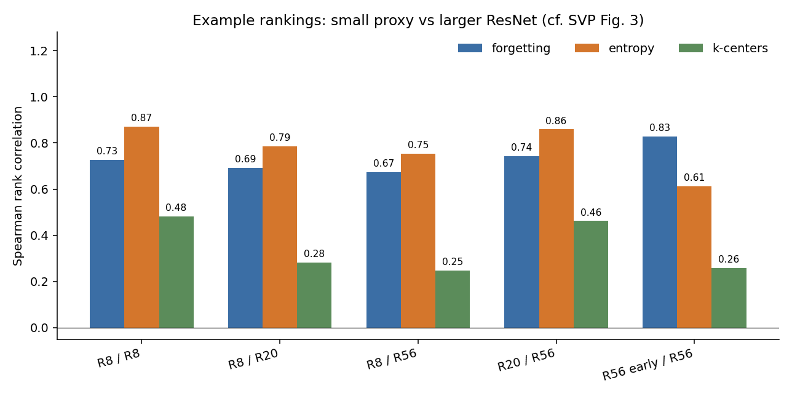
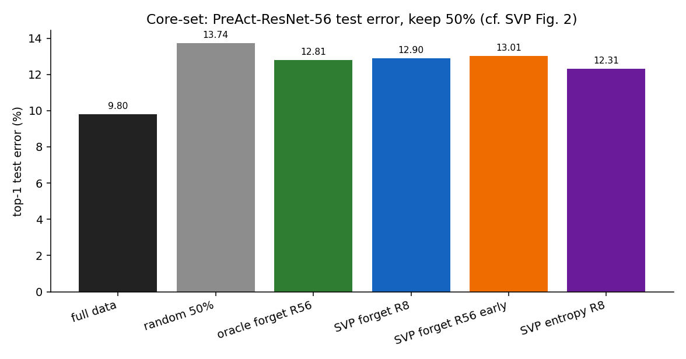
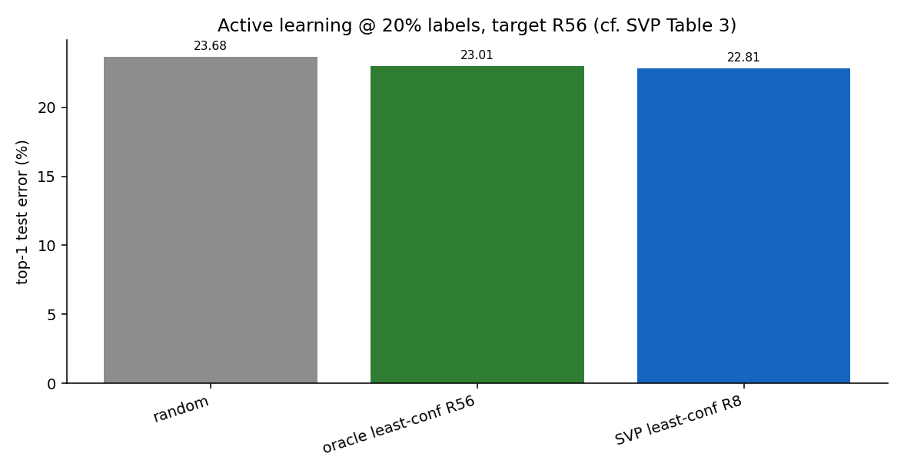
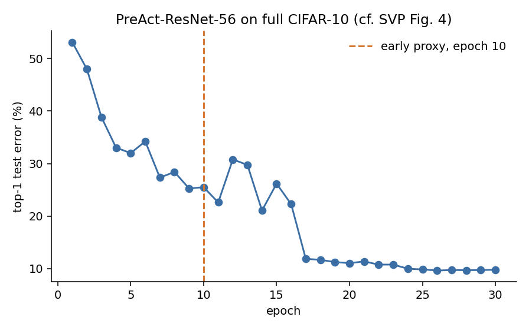

# Отчет. Selection via Proxy

Статья: [Coleman et al., "Selection via Proxy: Efficient Data Selection for Deep Learning", ICLR 2020](https://arxiv.org/abs/1906.11829).

Идея: дешевая proxy-модель (меньше слоев или меньше эпох) ранжирует примеры почти так же, как целевая модель. Core-set и active learning можно считать по proxy, а учить уже target модель.

Полный сетап статьи (PreAct-ResNet-164, 181 эпоха, 3-5 сидов, ImageNet и Amazon Reviews) не было возможности повторить. Прогон на CIFAR-10, один сид:

- прокси PreAct-ResNet-8, промежуточная PreAct-ResNet-20, целевая PreAct-ResNet-56
- 30 эпох, расписание lr как у авторов, сжатое до `1 x 0.01, 15 x 0.1, 7 x 0.01, 7 x 0.001`
- SGD, momentum 0.9, weight decay `5e-4`, batch 128
- core-set: оставить 50%
- active learning, least confidence: 2% случайных, затем 10%, затем 20%
- greedy k-centers только как корреляция рангов на 2000 точках

Число параметров совпало с Table 2 статьи: 0.078M, 0.272M, 0.856M. Ошибка на всех данных: R8 16.2%, R20 11.2%, R56 9.8%. В статье после 181 эпохи R20 около 7.6%, R164 около 5%. Глубже модель лучше, до абсолютных процентов статьи обучение не дошло.

## Что получилось воспроизвести

Ранги прокси близки к рангам целевой модели. Spearman корреляция по forgetting: два сида R8 дают 0.73, R8 и R56 дают 0.67, R20 и R56 дают 0.74. В статье R20 и R164 около 0.90. Здесь получилось ниже, но корреляция между разной глубиной того же порядка, что и между двумя прогонами одной сети. Entropy выше: 0.87 у двух сидов R8 и 0.75 у R8 и R56. Forgetting на эпохе 10 против финала R56 равен 0.83: порядок примеров на CIFAR-10 сходится рано, как пишут авторы.

Core-set 50%: прокси и оракул совпали, оба лучше случайной половины. Ошибка целевой R56:

| подмножество | top-1 error |
|---|---|
| все данные | 9.80% |
| entropy прокси R8 | 12.31% |
| forgetting оракула R56 | 12.81% |
| forgetting прокси R8 | 12.90% |
| forgetting R56 на эпохе 10 | 13.01% |
| случайные 50% | 13.74% |

Разница прокси и оракула 0.09 п.п. При одном сиде это одно и то же.

Active learning при 20% меток: случайная разметка 23.68%, отбор самой R56 23.01%, отбор R8 22.81%. Прокси не хуже оракула, обе немного лучше случайного выбора. В статье при 20% было 12.9%/10.4%/10.5%. Направление то же, зазор меньше: селектор на первой тысяче примеров за 30 эпох доучивается слабо.

## Что не получилось

Убрать 50% данных без роста ошибки. В статье forgetting почти не портил ResNet-164. Здесь любая половина хуже полных данных на 3-4 п.п. За 30 эпох в core-set попадают самые трудные примеры, и на них сеть за те же 30 эпох недоучивается.

В статье прокси дает ускорение около 1.6x на core-set и до 7x на active learning, потому что маленькая сеть дешевле большой по вычислениям. Здесь эпоха R8 и R56 занимала одно и то же время: узкое место было чтение данных (`num_workers=0`), не сама сеть. Обучение R8 плюс R56 на 50% вышло в 0.71x от одного полного прогона R56. Active learning дал 1.01x.

Greedy k-centers как способ собрать core-set на всех 50k не выполнялись расчеты: сложность квадратичная, в статье его тоже не запускали на ImageNet. Корреляция этой метрики слабая (0.25 у R8 и R56, 0.46 у R20 и R56). В статье она тоже самая низкая из трех.

Абсолютные ошибки не совпали, так как была другая целевая сеть, в шесть раз меньше эпох, один сид (ограничение вычислительных ресурсов)

